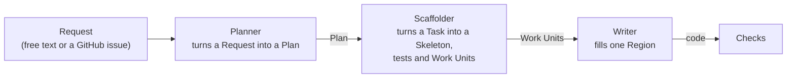

# The three tiers

Arbor splits every change across three model roles, called Tiers: the Planner, the Scaffolder and
the Writer. This is ADR-0001.

## Why the split exists

The point is to spend expensive-model tokens only on reasoning. The Planner and the Scaffolder are
agentic: they can call tools, read the repository and explore. The Writer is not. It is a single,
deterministic model call that sees only its Context Pack and returns only the code for one Region.

The strong models decide exactly what the cheap model needs to see, so the cheap model cannot
wander, read the repository or burn tokens exploring. The trade is that the Scaffolder has to pack
context precisely. When it does not, the Missing Response and the Escalation path recover the work.

The three roles map to three configurable models. The defaults are a large model for the Planner, a
mid model for the Scaffolder and a small model for the Writer. All three are set in
`arbor.toml` or the user config; see [Configuration](10-configuration.md).

## The two agentic Tiers

The Planner and the Scaffolder both run on the shared agent loop described in
[The agent loop](06-agent-loop.md). Each turn is one model call. The model may call tools, and it
ends its run by calling a submit tool whose arguments Arbor validates.

- The Planner may only read. It turns a Request into a Plan, and never writes code.
- The Scaffolder reads and writes. It turns a Task into a compilable Skeleton, the tests for that
  Task, and the Work Units the Writers will fill.

Neither may run arbitrary commands. That is ADR-0008; see [Tools](07-tools.md).

## The non-agentic Writer

The Writer is the piece the design is built around. For each Work Unit, Arbor makes one call at
temperature 0 with a fixed seed (where the model supports it), sends only the Work Unit's spec,
acceptance criteria and Context Pack, and expects exactly one fenced code block back. The Writer
never sees the repository, never runs a command, and never sees another Work Unit's work. Its output
is spliced into the file between two Marker comments by plain text matching; see
[Work Units, Regions and Markers](04-work-units-and-markers.md).

Because the Writer is cheap and isolated, the expensive work is deciding what to put in its Context
Pack and what the acceptance criteria are. Those are the Scaffolder's job.

## What each Tier produces

- Planner: a `Plan`, which has a goal, constraints and an ordered list of `Task`s. On a Replan it
  produces a `Replan`, which has a diagnosis and the Tasks that replace a failed one.
- Scaffolder: a set of `WorkUnit`s, one per Region, each with a spec, a Context Pack, acceptance
  criteria and a test filter. It also writes the Skeleton and the tests into the worktree. On a
  Revision it reworks the failed Work Units.
- Writer: the lines of code for one Region, or a Missing Response naming what its Context Pack
  lacked.

The domain types live in `arbor-core/src/types.rs`.

## Escalation between Tiers

When a piece of work keeps failing, Arbor hands it to the next Tier up: Writer to Scaffolder to
Planner to the human operator. The Writer retries a few times first; the Scaffolder gets a limited
number of Revisions; after that the Planner can Replan the Task; after that only the operator can
act. See [Verification and escalation](12-verification-and-escalation.md).
