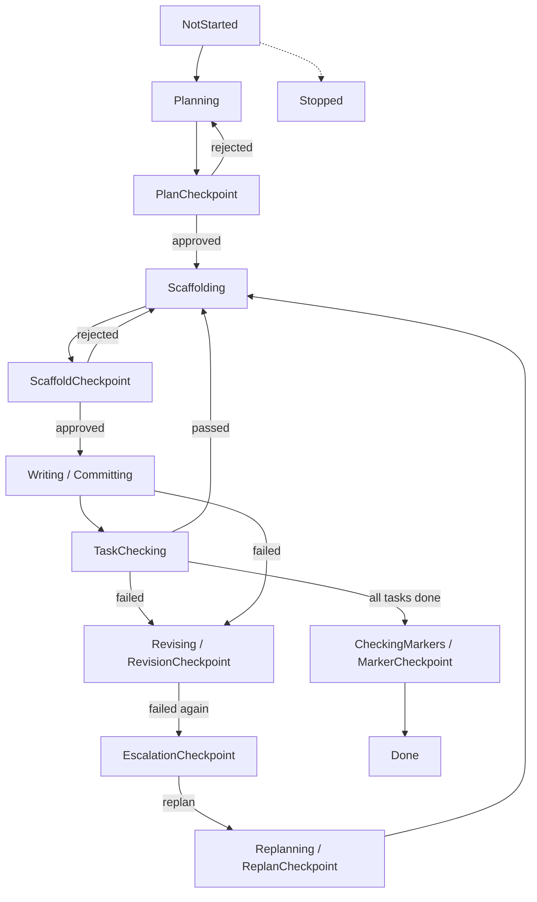

# The Session state machine

`arbor-core` holds the domain types and the Session state machine. It does no I/O. The rule is
ADR-0005: events in, effects out. Everything with a side effect, the model client, git, the tools
and the TUI, lives in another crate.

## Events in, effects out

The Session is built only by applying events. `Session::apply` takes one `Event` and returns the
`Effect`s that should follow it.

```rust
pub fn apply(&mut self, event: &Event) -> Result<Vec<Effect>, ApplyError>
```

`Event` is an enum of everything that can happen in a Session: `SessionStarted`, `PlanSubmitted`,
`PlanApproved`, `WorkUnitsSubmitted`, `WorkUnitPassed`, `WorkUnitFailed`, `WorkUnitCommitted`,
`TaskChecksPassed`, `RevisionSubmitted`, `ReplanSubmitted`, `MarkersChecked`, `UsageRecorded`,
`BudgetCapSet` and the rest. It lives in `arbor-core/src/event.rs`.

`Effect` is an enum of the things the outer crates should do next: `RunPlanner`,
`ShowPlanCheckpoint`, `RunScaffolder`, `RunScaffoldChecks`, `RunWriter`, `CommitWorkUnit`,
`RunTaskChecks`, `RunRevision`, `RunReplan`, `CheckMarkers`, `ShowBudgetCheckpoint`, `EndSession`
and the rest. It lives in `arbor-core/src/session.rs`.

An event that does not fit the current state is an `ApplyError` and leaves the state unchanged. That
is what makes an out-of-order or duplicated event safe.

## The event log is the source of truth

Each Session writes an append-only `events.jsonl`, one JSON event per line, flushed before the event
is shown. This is ADR-0004. Every state change is an event, so three features fall out of one
mechanism:

- Resume: replay the log to rebuild the Session.
- Rewind: replay up to an earlier event.
- Cost accounting: sum the `UsageRecorded` events.

`Session::replay` rebuilds a Session from a list of events. `arbor-core/src/log.rs` reads and writes
the log. A torn final line, written by a crash before it was flushed, is dropped on read, because
its event was never shown.

The trade is that every new state change must be modelled as an event. Adding a feature usually
means adding an `Event` variant and the transition that consumes it.

## Phases

The Session tracks where it is with a `Phase`. The phases run from `NotStarted` through planning,
scaffolding, writing, committing and the checkpoints, to `Done` or `Stopped`. The full set is in
`arbor-core/src/session.rs`.



## How a Task moves through the phases

The state machine drives one Task at a time. For each Task it scaffolds, runs the Scaffold Check,
waits at the Scaffold Checkpoint, commits the Skeleton, then writes each Work Unit in turn, commits
it, and finally runs the Task's full Unit Check. When every Task is done it checks the branch for
leftover Markers and finishes.

The `write_queue` field is the list of Work Unit IDs the current pass writes. On a fresh Task it is
every Work Unit. After a Revision it is only the rewritten ones, so passing Work Units are not
written twice.

## Two rules the state machine enforces

- One Replan per Task. A Task that came from a Replan cannot be replanned again; `may_replan`
  returns false and the only move left is the operator.
- One Missing Response per Work Unit. A Writer may send one `missing` reply per Work Unit;
  `may_send_missing_response` returns false after that, and a second one is rejected.

## The budget checkpoint

The Budget Cap is checked on every `apply`. While the Session is live and its total cost has reached
the cap, `apply` refuses every event except `BudgetCapSet`, `SessionStopped` and `UsageRecorded`.
That freezes the Session at the Budget Checkpoint until the operator raises the cap or stops. The
ordering rule matters: the runner records a call's outcome events before that call's
`UsageRecorded`, so the call that reaches the cap still lands its result, and the checkpoint opens
right after it. See [The Autopilot](03-autopilot.md) for how the pause is handled between calls.
