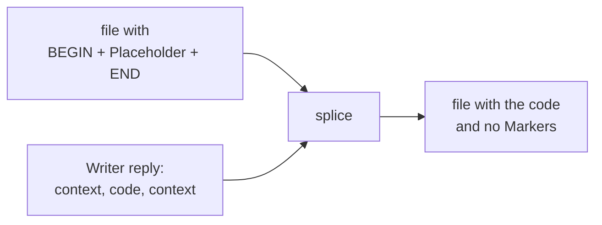

# Work Units, Regions and Markers

A Task is one step of a Plan. Arbor breaks each Task into Work Units. A Work Unit is the smallest
unit of work: one Region in one file, with a spec, a Context Pack, acceptance criteria and a test
filter. Exactly one Writer fills it. This is the shape that lets a cheap model write a small, well
specified piece of code without seeing the repository.

## The domain type

```rust
pub struct WorkUnit {
    pub id: WorkUnitId,
    pub file: String,
    pub spec: String,
    pub context: Vec<Snippet>,
    pub acceptance_criteria: Vec<String>,
    pub test_filter: String,
}
```

- `file` is the path holding the Region, relative to the worktree root.
- `spec` says what the code should do.
- `context` is the Context Pack: the snippets the Writer is allowed to see.
- `acceptance_criteria` are the things the code must satisfy.
- `test_filter` is substituted into `checks.unit_filtered` to run only this Work Unit's tests.

A `WorkUnitId` is shown and used in Markers as `WU-<n>`. IDs increase across a Session, so a later
Task's Work Units never reuse an earlier Task's ID.

## Regions and Markers

Arbor knows nothing about specific languages, so it cannot parse code to find a Region. Instead the
Scaffolder brackets each Region with Marker comments carrying the Work Unit ID. This is ADR-0002.

```
fn add(a: i32, b: i32) -> i32 {
    // ARBOR:BEGIN WU-7
    todo!()
    // ARBOR:END WU-7
}
```

Only the text `ARBOR:BEGIN WU-<n>` and `ARBOR:END WU-<n>` is matched, so any comment syntax works:
`//`, `#`, `--`, `/* */` and the rest. The parser looks for the keyword, checks that a whitespace
character follows it (so `ARBOR:BEGINNING` is not a Marker), then reads the `WU-<n>` ID.

The `Placeholder` inside the Region, such as `todo!()`, is what the Writer replaces. It has to
compile, because the Scaffold Check runs before any Writer.

`arbor-tiers/src/markers.rs` parses Markers, finds Regions and reports what is wrong with them:
malformed Markers, unclosed or unopened ones, mismatched pairs, nested Regions, duplicated IDs, and
Regions that sit too close together.

## Why Regions need space around them

The Writer echoes two unchanged lines of context on each side of its code, and they must match the
file. Those context lines are a sanity check that the Region is where the Writer thinks it is. If
two Regions are closer than two lines apart, the second Region's context lines would hold the first
Region's END Marker, which the first Writer strips, so the second Writer's context would no longer
match. The parser reports that as `TooClose`.

## Splicing

When a Writer returns code, Arbor replaces the Region body with it and strips the two Marker lines.
The splice keeps the file's line endings, so a file with `\r\n` stays that way.



The steps in `arbor-tiers/src/writer.rs`:

1. Read the file and find the Work Unit's Region. If it is missing or broken, the Writer ends and
   the failure goes to a Revision.
2. Take the two lines before the BEGIN Marker and the two after the END Marker.
3. Ask the reply to fit those context lines. If they do not match, the reply is rejected and the
   Writer retries.
4. Splice the code into the Region, run the Checks, and if they pass, strip the two Marker lines and
   commit.

If the Checks fail, the file is put back the way it was, Placeholder and all, and the failure goes
back to the Writer as a retry. If a Check rewrites the file, for example a formatter that moves a
Marker line, the code that is committed is the spliced code that passed, not the rewritten file, so
the Region cannot be broken by the Check.

## What a Marker is not

A Marker is only a well-formed `ARBOR:BEGIN WU-<n>` or `ARBOR:END WU-<n>`. A line that merely
mentions `ARBOR:`, for example in a doc or a constant, is not one. This matters for the end of
session check, which looks only for well-formed Markers in the lines the branch adds.

## Formats without comments

A file whose format has no comments cannot hold a Marker. JSON is the one such format Arbor knows
(`COMMENT_LESS_EXTENSIONS`). The Scaffolder may not make a JSON file a Work Unit; it has to write
that file itself as part of the Skeleton. The Scaffold Check also scans the worktree's changed files
for stray Markers in comment-less formats, ignoring Marker text that sits inside a string value.
