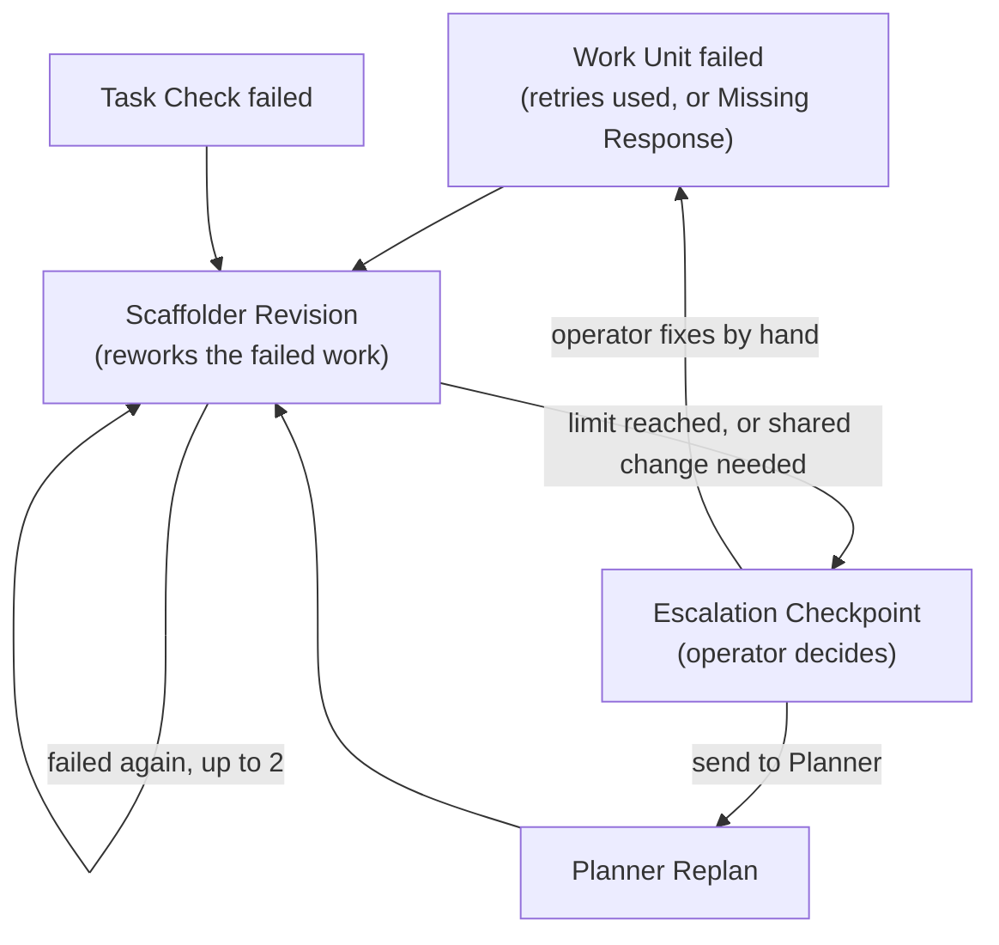

# Verification and escalation

Arbor verifies work by running the project's Checks, and escalates failures up the Tiers. This
document covers the Checks, the Revision and Replan loop, and the checkpoints where the operator
decides.

## Checks

A Check is a project-configured command Arbor runs to verify work. There are three, set in
`arbor.toml`:

- Scaffold Check: verifies that the Skeleton builds. Run before any Writer, and again as the
  Scaffolder submits.
- Unit Check: builds and runs the tests. Run when a Task's last Work Unit has passed.
- Filtered Unit Check: builds and runs only the tests matching one Work Unit's filter. Run for each
  Work Unit as its Writer's code is spliced.

The filtered check exists because the other Regions are still Placeholders while a Work Unit is
verified, so only that Work Unit's own tests can run. The full Unit Check runs when the Task
completes. This is ADR-0003.

A missing Check is a warning, not a failure. With no `unit` check, the Task passes and Arbor says it
skipped the tests.

## The failure loop

When a Work Unit fails, or a Task Check fails, Arbor tries to fix it before escalating.

## Revisions

A Revision is the Scaffolder's rework of a failed Work Unit's spec, Skeleton or Context Pack, with a
diagnosis of why it failed. The Scaffolder sees the failure, the Task diff, the Task's Work Units,
and the earlier Revisions, so it does not repeat one.

A Revision that only rewords the spec is rejected before it runs: `review_revision` checks whether
the Revision changed any Context Pack, acceptance criteria, test filter, file or Work Unit split, or
anything in the Skeleton or tests outside the Regions. A rejected Revision still counts toward the
limit.

Each failure gets at most `MAX_REVISIONS` (two) Revisions. A failed Work Unit and a failed Task
Check each count their own.

## The Escalation Checkpoint

When a failure has used up its Revisions, or a Revision reports that the fix needs a shared
signature or type that other Work Units depend on, the work goes to the Escalation Checkpoint. The
operator has three moves:

- Fix it by hand in the worktree. Arbor runs the Checks, and if the fix passes, commits it. The Work
  Unit it fixes loses its Markers, as when a Writer's code passes. If the fix fails the Checks, the
  operator is told and can try again.
- Send the Task to the Planner for a Replan. This is offered only once per Task.
- Stop, keeping the branch and worktree.

## Replan

A Replan is the Planner reworking a failed Task. It sees the approved Plan, the failed Task, the
failure chain, the earlier Revisions and the Task's diff. It produces a diagnosis and the Tasks that
replace the failed one. When the operator approves the Replan, the failed Task's commits are reset
and its work is forgotten, and the new Tasks run in its place. Work Unit IDs stay used, so the event
log never names two Work Units the same.

## The checkpoints

A Checkpoint is where the Session waits for the operator to approve, edit or reject a Tier's output.
Arbor has these:

- Plan Checkpoint: the operator approves the Plan, can drop or reorder Tasks, or rejects it with
  feedback.
- Scaffold Checkpoint: the operator approves the Skeleton, tests and Work Units, or rejects them
  with feedback.
- Revision Checkpoint: only when `revisions.checkpoints` is on. Approve or reject each Revision.
- Escalation Checkpoint: as above.
- Replan Checkpoint: approve or reject the Replan's Tasks.
- Marker Checkpoint: settle the leftover Markers before finishing. See
  [Markers and the mainline](13-markers-and-mainline.md).
- Budget Checkpoint: raise the Budget Cap or stop. See [The Autopilot](03-autopilot.md).

A rejected Plan or Skeleton runs the same Tier again with the feedback added to the prompt.

## The Failure Brief

When the operator retries a failed Work Unit with a stronger model, Arbor assembles a short summary
of the failures, mechanically, from the event log. The room it may use is set by
`failure_brief_tokens`, on top of the Writer Cap. This gives the stronger model the history of what
went wrong without replaying the whole Session.
