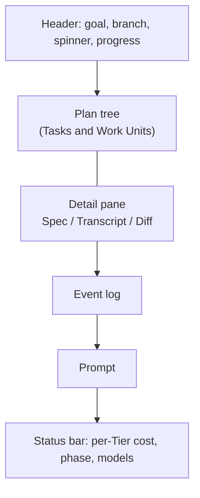

# The TUI

`arbor-tui` draws the screen. It shows the Session as the Autopilot runs it, and opens a modal
whenever the Session waits on the operator.

## The layout

The screen has a header, a main area split into the Plan tree and a detail pane, an event log, a
prompt, and a status bar.

- Plan tree: the Plan, its Tasks and each Task's Work Units, with a status icon per row. Tasks can
  be collapsed, and the tree follows the Session as it runs.
- Detail pane: the Request, the Plan, a Task, or a Work Unit. A Work Unit has three tabs: Spec (its
  spec, acceptance criteria and Context Pack), Transcript (each Writer reply and its outcome) and
  Diff (the committed code as a unified diff).
- Event log: one line per event, with the Tier and a tone, following new events unless scrolled
  back.
- Prompt: where the operator types the Request.
- Status bar: the cost and token counts per Tier, the total against the Budget Cap, the phase, the
  Clarification Mode and the models.

Keys move focus with Tab, scroll with the arrows, fold Tasks with left and right, and quit with `q`.
The key hints for the focused pane sit under the prompt.

## The view is folded from events

The Session state machine keeps only the current Task's Work Units, so the tree's history is built
separately. `SessionView` applies each event to its own copy of the Session and updates the tree and
the log to match. This is ADR-0004 again: the view is another replay of the event log. A Session
reloaded from its log rebuilds the same view.

The program running the TUI records each Writer reply as it comes, so the transcript shows attempts
that were not final events. Replaying a log only has the failed attempts, so those are filled in
from the failure record.

## The modals

When the Session waits on the operator, a modal opens. There is one for a checkpoint and one for a
Tier's questions.

- Plan and Replan modals list the Tasks, each kept or dropped, and let the operator reorder them.
- Scaffold and Revision modals show each Work Unit's spec, with assumptions highlighted, so the
  operator can check them before approving.
- Escalation, Marker and Budget modals each offer their own set of choices.
- The Questions modal shows the Tier's questions and takes the operator's answers.

Esc hides a modal so the operator can look around the Session, and `c` brings it back. The confirm
keys differ from the keys that ask, so a stray or doubled key press cannot stop a Session.

## The Session behind the screen

A Session runs on its own thread with the Autopilot, and streams updates to the screen over a
channel. The `ScreenOperator` sends each checkpoint and question to the screen and waits for the
reply, so the Session pauses in the right place rather than guessing.

Cancelling a Session drops the run future, which kills a running Check through `kill_on_drop`. If
the cancelled step had written files that no event records yet, such as a Writer's code still in its
Check, Arbor puts the worktree back to its last commit, so the kept worktree matches the event log.

## Leaving

When the operator quits with a Session unfinished, or a Session that ended without finishing,
Arbor warns about the Markers left in the branch and how many Regions still hold Placeholders. The
warning is shown once the terminal is back to normal, so it is not lost with the screen. A finished
Session with no Markers left needs no warning.
