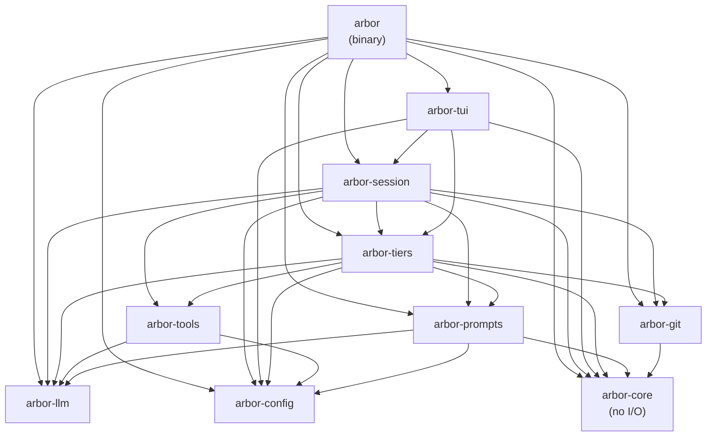

# Arbor architecture

These documents explain how each part of Arbor works, in enough depth to change the code. They are
for contributors. The top-level `README.md` stays short and points here.

Read them in order for a full picture, or jump to the one that matches the area you are working in.
The `docs/adr/` records hold the decisions behind the design; each document below links to the
ADRs it depends on.

## Contents

1. [The three tiers](01-three-tiers.md): the Planner, Scaffolder and Writer split, and why only
   two of them are agentic.
2. [The Session state machine](02-session-state-machine.md): the pure core, events in and effects
   out.
3. [The Autopilot](03-autopilot.md): the loop that carries out effects with the real Tiers, git and
   Checks.
4. [Work Units, Regions and Markers](04-work-units-and-markers.md): how a Task is split into pieces
   of code and how Arbor finds them in any language.
5. [The Tiers](05-tiers.md): what each of the three Tiers does.
6. [The agent loop](06-agent-loop.md): the shared turn loop the Planner and Scaffolder run on.
7. [Tools](07-tools.md): what the agentic Tiers may read and write, and the worktree boundary.
8. [The LLM layer](08-llm-layer.md): the OpenRouter client, model metadata and cost accounting.
9. [Prompts and Conventions](09-prompts-and-conventions.md): the per-Tier templates and the
   project's own guidance documents.
10. [Configuration](10-configuration.md): the user config, `arbor.toml` and how they merge.
11. [Git and Sessions](11-git-and-sessions.md): branches, worktrees, commits and remote approval.
12. [Verification and escalation](12-verification-and-escalation.md): Checks, Revisions, Replans
    and the escalation path.
13. [Markers and the mainline](13-markers-and-mainline.md): the checks that keep Markers out of
    `main`.
14. [The TUI](14-tui.md): the screen, the panes and the modals.
15. [CLI and entry points](15-cli-and-entry-points.md): the subcommands and how a run starts.
16. [Testing and CI](16-testing-and-ci.md): how the code is tested and what CI enforces.

## The workspace

Arbor is a Cargo workspace. The binary crate `arbor` wires everything together; the other crates
each own one concern. The rule that shapes the whole layout is ADR-0005: `arbor-core` holds the
domain types and the Session state machine and does no I/O at all. The crates around it carry out
the effects it asks for.

What each crate owns:

- `arbor-core`: the domain types (`Request`, `Plan`, `Task`, `WorkUnit`, `Tier`), the `Event` enum,
  the `Effect` enum, and the `Session` state machine. No file, network or process access.
- `arbor-config`: the user config, the project's `arbor.toml`, the API key, project detection and
  the paths they live at.
- `arbor-llm`: the `LlmClient` trait, the OpenRouter client, and a scripted fake for tests.
- `arbor-prompts`: the per-Tier prompt templates and the Conventions loader.
- `arbor-git`: the repository, the mainline, Session branches, worktrees, commits, diffs, the
  Marker scan's git reads, and reading a GitHub issue.
- `arbor-tools`: the agent tools the Planner and Scaffolder call, all confined to the Session
  worktree.
- `arbor-tiers`: the three Tiers, the shared agent loop, the Marker parser, the Scaffold Check and
  the Revision review.
- `arbor-session`: the Autopilot, which applies events to the Session and carries out the effects.
- `arbor-tui`: the terminal UI.
- `arbor` (binary): the CLI, `arbor init`, the git hooks, `arbor check-markers`, and the code that
  runs the TUI and a live Session behind it.
- `xtask`: a `check-core-deps` command that CI runs to keep `arbor-core` free of I/O crates.
